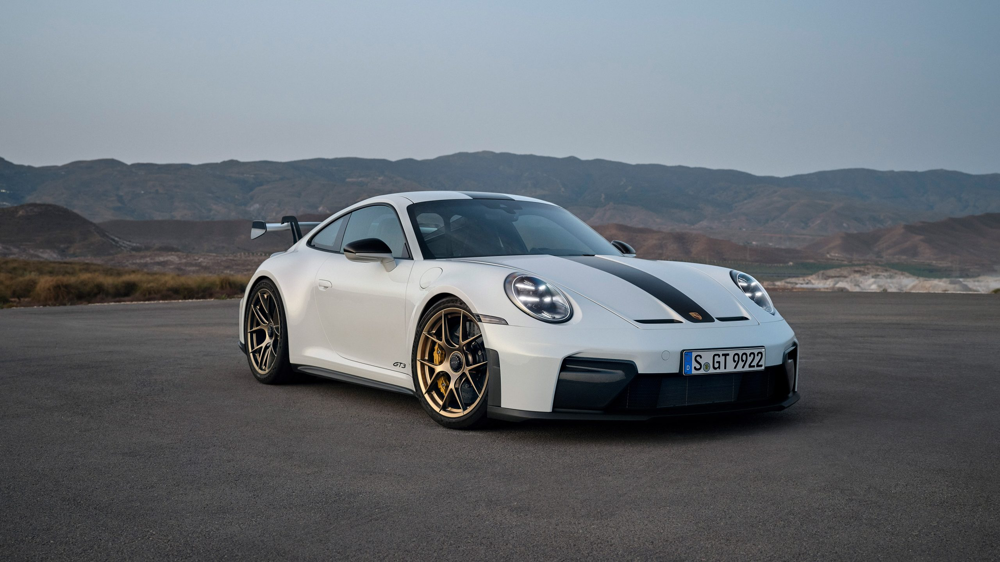

# Porsche 911 GT3 (992) — Interactive Web Showcase

An interactive, editorial-style landing page dedicated to the **Porsche 911 GT3 (992)**. Built with pure **HTML5, CSS3, and Vanilla JavaScript**, focusing on dark motorsport aesthetics, smooth micro-interactions, real-time 3D customization, and responsive design.

> **Live Demo:** [View Live on Vercel](https://porsche-911-gt3-showcase.vercel.app)



---

## Key Features

- **Cinematic Hero Section:** Full-screen track video background with responsive mobile framing (`48svh` crop on smaller viewports) and smooth gradient masking.
- **Technical Specifications & Animated Metrics:** Open hairline-grid layout featuring `IntersectionObserver`-triggered count-up animations (`510 KM`, `3.4 s`, `318 km/h`, `9 000 RPM`) using `requestAnimationFrame` with cubic easing.
- **Exhaust Sound Lab (Hold-to-Listen):** Interactive audio player supporting mouse, touch, and keyboard (`Space` / `Enter`) with a real-time CSS waveform visualizer.
- **Interactive 3D Configurator (`<model-viewer>`):**
  - 360° model inspection with custom loading progress bar and responsive camera orbit.
  - Live **PBR Material manipulation** for 6 exterior paint colors (dynamically stripping the baked base texture) and 4 forged rim finishes (`Gold`, `Silver`, `Black`, `Carbon`).
  - Custom-separated rim material (`Rim_Paint`) prepared in Blender and runtime transparency fixes for the cockpit.
- **Aerodynamics CFD & Hotspots:** Multi-layered SVG wind-tunnel streamline animation paired with clickable engineering hotspots (`NACA Ducts`, `911 RSR Double-Wishbone`, `Swan-Neck Wing`, `Venturi Diffuser`).
- **Editorial Horizontal Filmstrip Gallery:** Asymmetric interior showcase with varied aspect ratios (`16:10`, `4:5`, `5:4`), desktop click-and-drag scrolling with inertia/momentum physics, touch `scroll-snap` on mobile, and a live progress bar.
- **Navigation & UX:** `IntersectionObserver` ScrollSpy, accessible off-canvas mobile drawer (`Escape` & click-outside support), SEO meta tags, Open Graph cards, and full favicon/manifest setup.

---

## Tech Stack

- **HTML5** — Semantic markup, SEO & Open Graph meta tags
- **CSS3** — Custom properties, Mobile-First Grid & Flexbox, CSS animations, `overflow-x: clip`
- **JavaScript (ES6+)** — `IntersectionObserver` (ScrollSpy, Scroll Reveal, Counters), Web Audio control, Drag-to-Scroll momentum physics, `<model-viewer>` Material API
- **3D & Tooling** — Google `<model-viewer>` v3.4.0, Blender (material separation for `.glb`)

---

## Project Structure

```text
├── assets/
│   ├── favicon_io/          # App icons & site.webmanifest
│   ├── Porsche_911_gt3_3D.glb
│   ├── porsche-911-gt3rs.mp3
│   ├── video.mp4
│   └── *.jpg / *.png / *.avif / *.webp
├── index.html
├── style.css
├── script.js
└── README.md
```

---

## Getting Started

1. Clone the repository:
   ```bash
   git clone https://github.com/Patrykly/porsche-911-gt3-showcase.git
   ```
2. Open the project folder and run it with a local server (e.g. VS Code **Live Server**) so that the `.glb` 3D model and audio assets load properly without CORS restrictions.

---

## Disclaimer & Credits

This is a **non-commercial educational portfolio project** by **Patrykly** and is not affiliated with Porsche AG.

- **3D Model:** [Sketchfab — 2025 Porsche 911 GT3 (992.2)](https://sketchfab.com/3d-models/2025-porsche-911-gt3-992-2-1503f8d08f154ec7ab52f95a99c55134)
- **Photography & Video:** [Porsche](https://www.porsche.com/poland/models/911/911-gt3-models/911-gt3/), [YouTube](https://www.youtube.com/watch?v=dyHSbRD0_sE)
- **Exhaust Audio:** [Myinstants](https://www.myinstants.com/en/instant/porsche-911-gt3rs-61628/)
